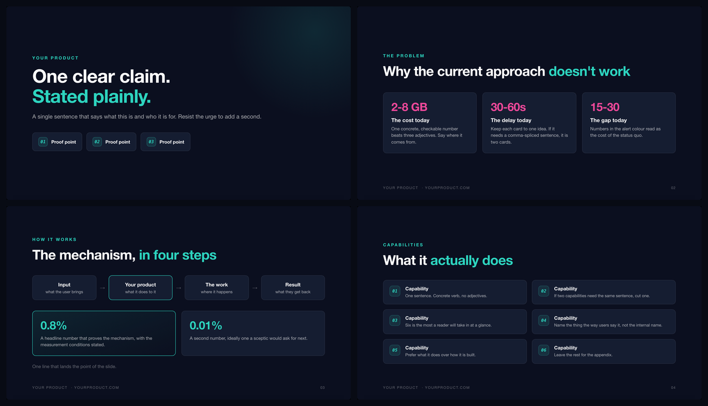

# Deckloom

[](https://skills.sh/kritikmodi/deckloom)

Let your AI build decks for you. Tell your coding agent what the deck should
say; it edits a JSON file, and headless Chrome renders a PDF at exactly
PowerPoint's 16:9 page size. Export to `.pptx` if someone needs one. Works with
Claude Code, Codex, Cursor, Copilot and any other agent that can edit a file.

Pitch decks, investor overviews, one-pagers, sales decks, technical overviews,
brochures, conference talks. One content file, many decks.


The agent panel is a mock-up; the slides are not. They are exactly what
`scripts/build.py` renders from that `content.json`.

```
content.json ──► deck.html ──► headless Chrome ──► deck.pdf ──► deck.pptx
     (words)      (design)        (layout)          (share)      (optional)
```

## Why this exists

Nobody makes a deck once. The same twelve facts get recut as an investor
overview, a sales deck, a one-pager and a technical brief. A month later the four
versions disagree about the numbers, and nobody knows which is current.

That is a version control problem wearing a design costume. So keep the content
in one file, keep the design in another, and render whichever deck you need. A
number changes in one place. A rebrand is a few CSS variables. A wording change
shows up in a diff.

## The core idea

**Content and design never live in the same file.**

`content.json` has the words. `deck.html` has the slide types and the brand.
Neither knows about the other until build time. That is what makes recuts,
rebrands and reviews cheap.

## Install

```bash
git clone https://github.com/kritikmodi/deckloom.git
cd deckloom
pip install -r requirements.txt && playwright install chromium
```

**Any agent.** `AGENTS.md` at the repo root is read natively by Codex, Cursor,
Copilot, Gemini CLI, Aider, Windsurf, Zed and others.

**Claude Code.** Install it as a plugin, from inside a session:

```
/plugin install deckloom --marketplace kritikmodi/deckloom
```

Or from your shell:

```bash
claude plugin marketplace add kritikmodi/deckloom
claude plugin install deckloom@deckloom
```

Then run it from your own project: outputs land there, not in the plugin.
Without the plugin system, copy it in as a skill instead:

```bash
cp -r deckloom ~/.claude/skills/deckloom
```

**No agent at all.** Plain Python and a headless browser. No vendor SDK, no model
API, nothing to sign up for.

## Build a deck

```bash
cp templates/deck.html templates/content.example.json .
mv content.example.json content.json

python3 scripts/build.py                   # -> out/deck.pdf
python3 scripts/build.py --png             # also one PNG per slide
python3 scripts/export_pptx.py             # -> out/deck.pptx
```

The bundled example renders seven slides covering every slide type, so a clean
clone produces a real deck before you have written anything.

While writing, open `deck.html` in a browser and reload. It scrolls as a stack of
slides on screen and paginates correctly when printed.

## One content file, many decks

Name the slides, then list which ones each audience gets:

```json
"cuts": {
  "investor": ["hero", "problem", "how", "traction", "close"],
  "onepager": ["hero", "capabilities", "close"]
}
```

```bash
python3 scripts/build.py --cut investor --out out/investor.pdf
python3 scripts/build.py --cut onepager --out out/onepager.pdf
```

Every cut reads from the same slides, so they cannot drift apart.

## Match the product's brand automatically

Point it at the product's codebase and it works out the palette:

```bash
python3 scripts/detect_brand.py ../my-product --write content.json
```

```
  theme
    accent   #005F96   <- most saturated colour (name match was grey)
    bg       #0F1117   <- bg (css-var)
    surface  #1E2026   <- derived from bg (detected value was a different theme)
    ink      #E6E8EF   <- text (css-var)
    alert    #FF5A5B   <- danger (css-var)

  rejected (kept the deck coherent)
    surface #FFFFFF rejected: luma 1.00 vs bg 0.07, not the same theme
    accent #A8B4C2 rejected: saturation 0.13 is too low to read as an accent

  fonts     Inter
  icons     lucide-react
  logos     gui/public/icon/logo-wordmark-dark.svg
```

It reads design token files, tailwind configs, CSS custom properties, SCSS and
Less variables, JS/TS theme objects and the web manifest. Build output is
skipped, because a `dist/` folder is full of vendored component-library CSS that
is not the brand.

Crucially it checks the palette holds together rather than trusting name matches
alone. A repo that defines `--surface` for its light theme and `--bg` for its
dark one would otherwise produce a white card on a black slide. Rejections are
printed, never applied silently.

## Slide types



| Type | For | Notes |
|---|---|---|
| `title` | the opening claim | eyebrow, two-line headline, proof chips |
| `stats` | the problem, in numbers | three cards, alert-coloured figures |
| `flow` | how it works | left-to-right steps, optional stat panels |
| `features` | capability grid | up to six, two columns |
| `table` | comparison | `+` accent cell, `-` alert cell |
| `quote` | a customer sentence | the only slide where someone else talks |
| `closing` | the ask | make it specific |

Wrap a phrase in `~tildes~` to colour it with the accent, so copy stays free of
markup. Adding a type is one function in `deck.html`; page sizing, footers,
numbering and print rules are handled for you.

## What's here

| Path | |
|---|---|
| `SKILL.md` | the brief: pipeline, slide types, rules for good decks |
| `scripts/build.py` | content + design to PDF, with cuts and PNG export |
| `scripts/export_pptx.py` | PDF to PowerPoint, one image per slide |
| `scripts/detect_brand.py` | read colours, fonts, icons and logos out of a codebase |
| `templates/deck.html` | the slide system and design tokens |
| `templates/content.example.json` | a worked example of every slide type |
| `references/DESIGN.md` | tokens, type scale, how to rebrand |
| `references/SLIDE-TYPES.md` | what each type is for and how it fails |
| `references/PITFALLS.md` | read before debugging |

## Honest limits

The PPTX contains one full-bleed image per slide. It presents correctly anywhere
and survives being emailed, but the text is not editable in PowerPoint. That is
the trade: wording changes belong in `content.json`, not in a copy of the file
someone has on their laptop. If a colleague genuinely needs native editable
shapes, this is the wrong tool.

Dark decks look excellent on screen shares and projectors, and poor when printed
or presented in a bright room. `references/DESIGN.md` covers inverting the
tokens.

This is for decks that are mostly type, numbers and diagrams, which is most
product decks. It is not an illustration tool.

## Related

The same idea applied to video: [product-video-as-code](https://github.com/kritikmodi/product-video-as-code).

## License

MIT (c) 2026 Kritik Modi - see [LICENSE](LICENSE).

<!--
GitHub repo description (About field, set in repo settings):
Let your AI build decks for you

Suggested topics: claude-skill, claude-code, presentation, slides, pptx, pdf,
playwright, deck-as-code, pitch-deck, developer-marketing
-->
