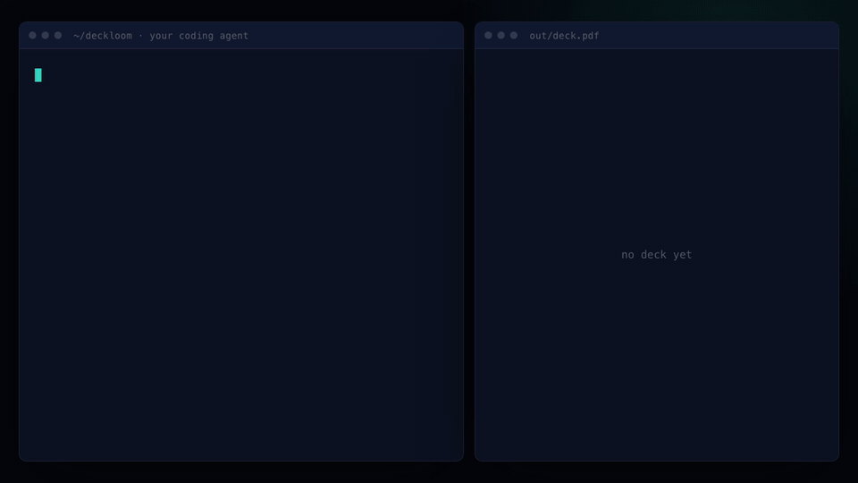

# Deckloom

[](https://skills.sh/kritikmodi/deckloom)

**Let your AI build decks for you.**

Ask your coding agent for a deck. It writes the words into `content.json`, and
Deckloom renders a PDF (and a PPTX if you want one).



## Install

In Claude Code:

```
/plugin install deckloom --marketplace kritikmodi/deckloom
```

Any other agent (Codex, Cursor, Copilot and more):

```bash
npx skills add kritikmodi/deckloom
```

## Use it

Just ask:

> Make a 5-slide investor deck for this repo, in our app's colours.

Or run it yourself:

```bash
pip install -r requirements.txt
playwright install chromium
cp templates/deck.html .
cp templates/content.example.json content.json
python3 scripts/build.py           # -> out/deck.pdf
python3 scripts/export_pptx.py     # -> out/deck.pptx
```

The install downloads Playwright from PyPI and a headless Chromium. Building a
deck makes no network calls.

## Why

- **One file for the words, one for the design.** Change a number once, and
  every deck that uses it updates.
- **Many decks from one file.** Investor, sales and one-pager cuts never
  disagree.
- **Your brand, read from your code.** No hex codes to look up.

The PPTX is one image per slide, so its text isn't editable in PowerPoint.

More in [SKILL.md](SKILL.md). Same idea for video:
[product-video-as-code](https://github.com/kritikmodi/product-video-as-code).

MIT licensed.
